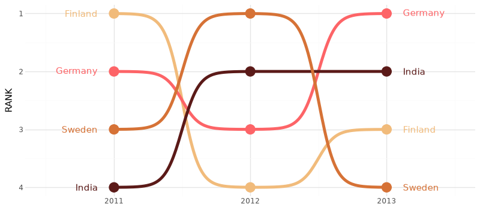

# ggbump

Bump charts and sigmoid curves for [plotnine](https://plotnine.org): a Python port of the R package
[ggbump](https://github.com/davidsjoberg/ggbump) by David Sjöberg. Plots are checked against R's with
[plotparity](https://github.com/snake-case-ggtext/plotparity).



## Install

```bash
pip install git+https://github.com/<you>/ggbump   # Python 3.10+, plotnine 0.15
```

## Usage

```python
import pandas as pd
from plotnine import aes, geom_point, ggplot, scale_y_reverse
from ggbump import geom_bump, geom_sigmoid

df = pd.DataFrame(
    {
        "country": ["India"] * 3 + ["Sweden"] * 3 + ["Germany"] * 3 + ["Finland"] * 3,
        "year": [2011, 2012, 2013] * 4,
        "rank": [4, 2, 2, 3, 1, 4, 2, 3, 1, 1, 4, 3],
    }
)

(
    ggplot(df, aes("year", "rank", color="country"))
    + geom_bump(size=2)  # smooth=8, direction="x" by default
    + geom_point(size=6)
    + scale_y_reverse()
)
```

| Name | What it does |
|---|---|
| `geom_bump(smooth=8, direction="x")` | A line per group that steps smoothly from point to point. x may be numeric or categorical. |
| `geom_sigmoid(smooth=8, direction="x")` | One sigmoid curve per row, from `(x, y)` to `(xend, yend)`. |
| `stat_bump`, `stat_sigmoid` | The stats behind them, to draw with another geom: `stat_bump(geom="point")`. |
| `sigmoid(x_from, x_to, y_from, y_to, smooth=5, n=100, direction="x")` | The curve's points as a DataFrame. |
| `rank_sigmoid(x, y, smooth=8, direction="x")` | Curves joining consecutive points, as a DataFrame. |

Higher `smooth` makes each step sharper. `direction="y"` smooths along y. Line widths follow plotnine
(`size`, as in `geom_line`); R's `linewidth` is accepted as an alias. More in the
[gallery](docs/gallery.md); differences from R are in [docs/differences.md](docs/differences.md).

## Development

Everything runs in one [pixi](https://pixi.sh) environment with Python, R and the tools:

```bash
pixi install
pixi run install-r-upstream   # R ggbump (development version), from its local clone
pixi run prek install         # git hooks
pixi run test                 # pytest
pixi run lint                 # ruff + pyrefly
pixi run parity run --no-render-r   # compare with R through plotparity
pixi run parity selftest      # check that plotparity catches the bugs in mutations/
pixi run gallery              # regenerate docs/images and docs/gallery.md
```

### Design notes

The port subclasses plotnine's `stat` and `geom_line` and relies on these plotnine 0.15 behaviours:

- `stat.compute_panel` copies each group's constant columns (colour, …) onto the computed curve,
  as R's join does. Caught by `tests/test_numeric_inputs.py::test_discrete_x_one_curve_per_step`.
- `geom_path` draws groups in group order, so later groups are on top where curves cross, as in R.
  Caught by the `curve_paint_order` parity check (mutation `reversed_paint_order`).
- `stat="bump"` resolves through plotnine's class registry by the name `stat_bump`.
  Caught by every parity case and test.

## License

MIT. The curve maths and stats are translated from R ggbump (MIT, © 2020 David Sjöberg).
