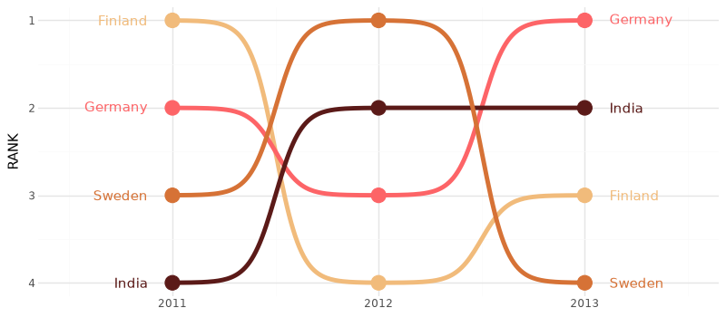
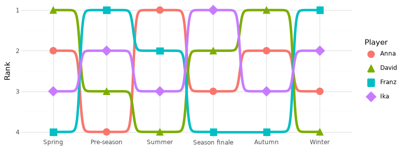
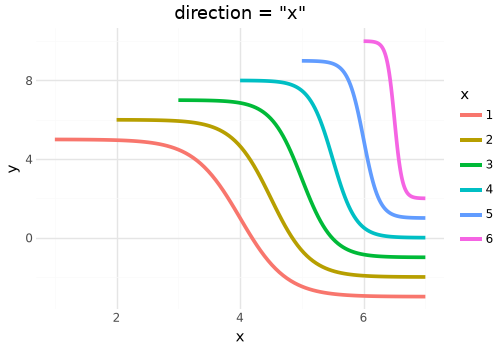
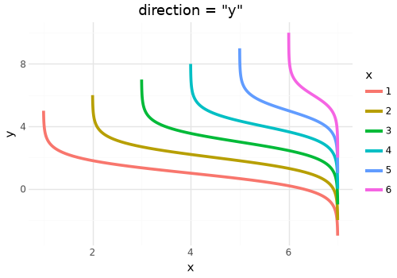

# Gallery

Every image in the documentation, with the code that made it. The scripts live in `examples/`; run `python examples/run_all.py` to regenerate the images and `python examples/make_gallery.py` to rebuild this page.

| Example | Script |
|---|---|
| [Bump chart](#bump-chart) | `examples/01_bump_chart.py` |
| [Ordered categories on the x axis](#discrete-x) | `examples/02_discrete_x.py` |
| [Sigmoid curves](#sigmoid) | `examples/03_sigmoid.py` |

<a id="bump-chart"></a>

## Bump chart

Rank over time: one smooth line per country, points at each observation and
labels at both ends. Rank 1 is at the top.



<details><summary>Code: <code>examples/01_bump_chart.py</code></summary>

```python
"""
Bump chart

Rank over time: one smooth line per country, points at each observation and
labels at both ends. Rank 1 is at the top.
"""

import os
from pathlib import Path

import pandas as pd
from plotnine import (
    aes,
    geom_point,
    geom_text,
    ggplot,
    labs,
    scale_color_manual,
    scale_x_continuous,
    scale_y_reverse,
    theme,
    theme_minimal,
)

from ggbump import geom_bump

OUT = Path(
    os.environ.get(
        "GGBUMP_EXAMPLES_OUT", Path(__file__).parent.parent / "docs" / "images"
    )
)
OUT.mkdir(parents=True, exist_ok=True)

df = pd.DataFrame(
    {
        "country": ["India"] * 3 + ["Sweden"] * 3 + ["Germany"] * 3 + ["Finland"] * 3,
        "year": [2011, 2012, 2013] * 4,
        "rank": [4, 2, 2, 3, 1, 4, 2, 3, 1, 1, 4, 3],
    }
)
first, last = df[df["year"] == 2011], df[df["year"] == 2013]

p = (
    ggplot(df, aes("year", "rank", color="country"))
    + geom_bump(size=2, smooth=8)
    + geom_point(size=6)
    + geom_text(aes(x="year - .12", label="country"), data=first, ha="right", size=11)
    + geom_text(aes(x="year + .12", label="country"), data=last, ha="left", size=11)
    + scale_x_continuous(limits=(2010.5, 2013.5), breaks=[2011, 2012, 2013])
    + scale_y_reverse()
    + scale_color_manual(values=["#F1BB7B", "#FD6467", "#5B1A18", "#D67236"])
    + labs(x="", y="RANK")
    + theme_minimal()
    + theme(legend_position="none", figure_size=(8, 3.5))
)
p.save(OUT / "bump_chart.png", dpi=100, verbose=False)
```

</details>

<a id="discrete-x"></a>

## Ordered categories on the x axis

geom_bump works with a categorical x too. Each step is drawn between a
player's consecutive seasons, in the order of the categories. `smooth`
sets how sharp each step is.



<details><summary>Code: <code>examples/02_discrete_x.py</code></summary>

```python
"""
Ordered categories on the x axis

geom_bump works with a categorical x too. Each step is drawn between a
player's consecutive seasons, in the order of the categories. `smooth`
sets how sharp each step is.
"""

import os
from pathlib import Path

import pandas as pd
from plotnine import (
    aes,
    geom_point,
    ggplot,
    labs,
    scale_y_reverse,
    theme,
    theme_minimal,
)

from ggbump import geom_bump

OUT = Path(
    os.environ.get(
        "GGBUMP_EXAMPLES_OUT", Path(__file__).parent.parent / "docs" / "images"
    )
)
OUT.mkdir(parents=True, exist_ok=True)

seasons = ["Spring", "Pre-season", "Summer", "Season finale", "Autumn", "Winter"]
df = pd.DataFrame(
    {
        "season": pd.Categorical(seasons * 4, categories=seasons),
        "rank": [
            1,
            3,
            4,
            2,
            1,
            4,
            2,
            4,
            1,
            3,
            2,
            3,
            4,
            1,
            2,
            4,
            4,
            1,
            3,
            2,
            3,
            1,
            3,
            2,
        ],
        "player": [p for p in ("David", "Anna", "Franz", "Ika") for _ in seasons],
    }
)

p = (
    ggplot(df, aes("season", "rank", color="player"))
    + geom_bump(size=2, smooth=20, show_legend=False)
    + geom_point(aes(shape="player"), size=5)
    + scale_y_reverse()
    + labs(x="", y="Rank", color="Player", shape="Player")
    + theme_minimal()
    + theme(figure_size=(8, 3))
)
p.save(OUT / "discrete_x.png", dpi=100, verbose=False)
```

</details>

<a id="sigmoid"></a>

## Sigmoid curves

geom_sigmoid draws one curve per row, from (x, y) to (xend, yend).
`direction="y"` smooths along y instead of x.





<details><summary>Code: <code>examples/03_sigmoid.py</code></summary>

```python
"""
Sigmoid curves

geom_sigmoid draws one curve per row, from (x, y) to (xend, yend).
`direction="y"` smooths along y instead of x.
"""

import os
from pathlib import Path

import pandas as pd
from plotnine import aes, ggplot, labs, theme, theme_minimal

from ggbump import geom_sigmoid

OUT = Path(
    os.environ.get(
        "GGBUMP_EXAMPLES_OUT", Path(__file__).parent.parent / "docs" / "images"
    )
)
OUT.mkdir(parents=True, exist_ok=True)

df = pd.DataFrame(
    {"x": range(1, 7), "y": range(5, 11), "xend": 7, "yend": range(-3, 3)}
)


def sigmoids(direction: str) -> ggplot:
    return (
        ggplot(df, aes(x="x", xend="xend", y="y", yend="yend", color="factor(x)"))
        + geom_sigmoid(size=1.5, direction=direction)
        + labs(color="x", title=f'direction = "{direction}"')
        + theme_minimal()
        + theme(figure_size=(5, 3.5))
    )


sigmoids("x").save(OUT / "sigmoid_x.png", dpi=100, verbose=False)
sigmoids("y").save(OUT / "sigmoid_y.png", dpi=100, verbose=False)
```

</details>
